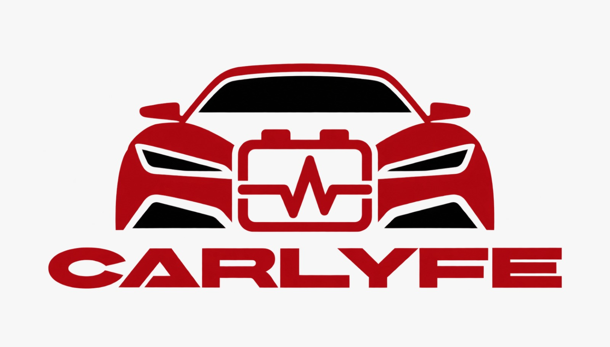
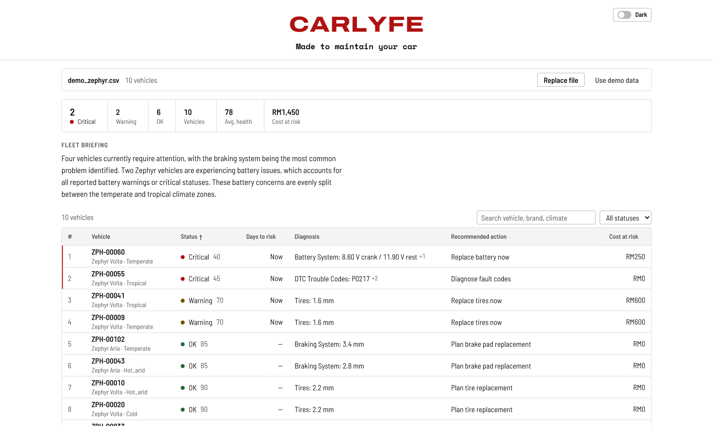
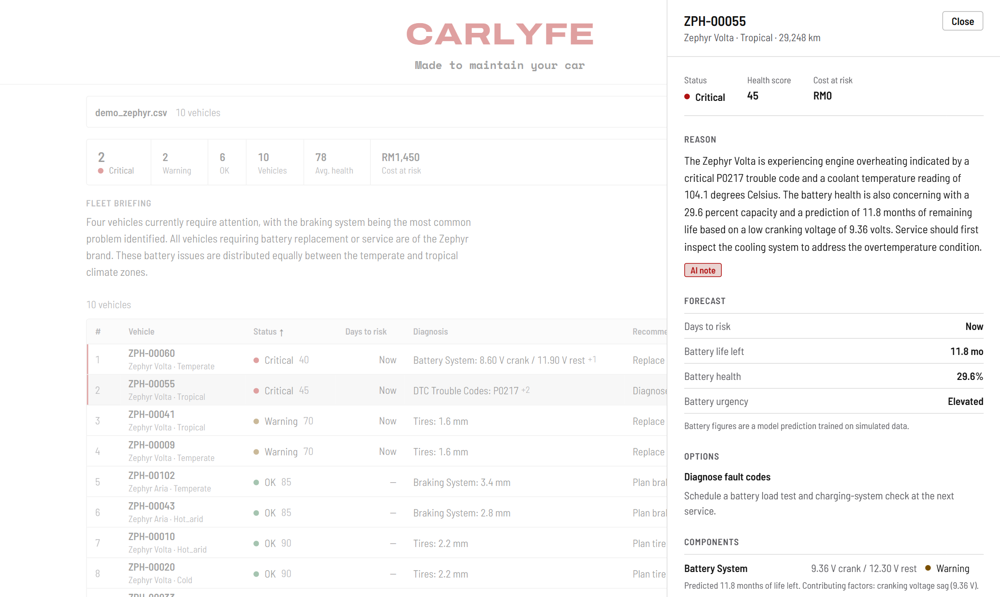
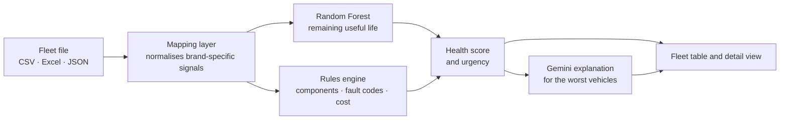

<div align="center">



# CARLYFE

**Made to maintain your car.**

Predictive battery maintenance for vehicle fleets.

<br>


[**Live API**](https://carlyfe.onrender.com/docs) &nbsp;·&nbsp; [Overview](#overview) &nbsp;·&nbsp; [How it works](#how-it-works) &nbsp;·&nbsp; [Getting started](#getting-started) &nbsp;·&nbsp; [API](#api)

</div>

<br>

## Overview

CarLyfe is a predictive maintenance tool for vehicle fleets. A fleet manager uploads telematics data (CSV, Excel or JSON) and the app scores every vehicle's 12V battery.

For each vehicle it shows:

| What you see | What it tells you |
| --- | --- |
| **Time to failure** | How many days until the battery is likely to fail, as a range rather than a single number. |
| **Root cause** | What is causing the problem: normal aging, a charging-system fault, or something draining the battery while parked. |
| **Urgency** | Critical, Warning or OK, with vehicles ranked so the most urgent are at the top. |
| **Reason and action** | A plain-language reason and a recommended action with its cost, such as replace the battery, inspect the alternator, or check for a drain. |

It also shows what the fleet saves compared with the usual alternatives: replacing batteries only when they die, or replacing them on a fixed schedule.

### Who it's for

Fleet operators and car companies, not individual drivers. They manage many vehicles and lose money when one doesn't start or when a good battery is replaced too early.

### The problem

- Unexpected breakdowns disrupt business operations.
- Replacing parts too early wastes money.
- Fixed maintenance schedules cannot reflect every vehicle's actual condition.

<br>

## Screenshots

Both screenshots use a real upload: `demo_zephyr.csv` (10 Zephyr vehicles), analysed by the live API with AI explanations on.

<p align="center">
  
</p>
<p align="center"><em>The fleet after uploading <code>demo_zephyr.csv</code>: summary strip, AI fleet briefing and the table ranked worst first. Critical vehicles carry a red rule on the left.</em></p>

<p align="center">
  
</p>
<p align="center"><em>Detail panel for a critical vehicle (ZPH-00055): the AI explanation of why it is flagged, the battery forecast, the recommended action and every component.</em></p>

<br>

## How it works



1. **Ingest.** Each manufacturer names its signals differently. The mapping layer reads a file in any of the supported formats and maps it onto one common schema, reporting any signal it could not map.
2. **Predict.** A Random Forest regression model estimates each battery's remaining useful life from battery age, trip pattern, resting and cranking voltage, alternator output, mileage and climate zone.
3. **Check.** A rules engine evaluates the battery, brakes, tires, cooling loop, fuel trim and diagnostic trouble codes, and attaches a repair cost to each issue.
4. **Rank.** Every vehicle gets an overall health score and status, and the fleet is sorted so the most urgent come first.
5. **Explain.** For the worst vehicles in each upload, an LLM (Gemini, through the Grafilab API) writes a short plain-language reason. It is only given the computed facts and is told not to invent causes, parts or numbers.

> **Note on the model.** The battery model was trained on a simulated dataset, because the public Kaggle dataset covers only lithium-ion batteries in EVs. Predictions should be read as estimates and are labelled that way in the app.

<br>

## Tech stack

| Layer | Technology |
| --- | --- |
| Frontend | Next.js 16, React 19, TypeScript, plain CSS with design tokens |
| Backend | FastAPI, Uvicorn, pandas, NumPy |
| Machine learning | scikit-learn Random Forest, saved with joblib |
| AI explanations | Gemini (`gemini-3.1-flash-lite-preview`) through the Grafilab OpenAI-compatible API |
| Hosting | Render (API) |

<br>

## Getting started

### Prerequisites

- Node.js 20 or newer
- Python 3.10 or newer

### Run the frontend

```bash
cd Frontend
npm install
npm run dev
```

Open <http://localhost:3000>. Choose **Use demo data** to see the interface straight away, or upload one of the files from `Frontend/public/samples/`.

By default the app calls the hosted API at `https://carlyfe.onrender.com`. To point it at a local backend instead, create `Frontend/.env.local`:

```bash
NEXT_PUBLIC_API_URL=http://localhost:8000
```

> The hosted API runs on a free tier and can take up to a minute to wake after sitting idle. If it is slow or unreachable, the app falls back to 30 bundled demo vehicles (`Frontend/public/static_fallback.json`) and says so.

### Run the backend

```bash
cd Backend
python -m venv .venv
.venv\Scripts\activate          # macOS / Linux: source .venv/bin/activate
pip install -r requirements.txt
uvicorn main:app --reload
```

The API is then at <http://localhost:8000>, with interactive docs at <http://localhost:8000/docs>.

AI explanations are optional. Set these to enable them:

| Variable | Purpose | Default |
| --- | --- | --- |
| `GRAFILAB_API_KEY` | Enables the LLM explanations. Without it, `ai_explanation` is `null`. | none |
| `GRAFILAB_MODEL` | Model used for explanations. | `gemini/gemini-3.1-flash-lite-preview` |
| `MAX_AI_VEHICLES` | How many of the worst vehicles get an explanation per upload. | `10` |

<br>

## API

| Method | Endpoint | Description |
| --- | --- | --- |
| `POST` | `/analyze` | Upload a file (form field `file`). Add `?ai=true` to include AI explanations. Returns one result per vehicle. |
| `POST` | `/summarize` | Send the list returned by `/analyze` to get a short fleet briefing. |
| `GET` | `/health` | Service status, model details and whether AI explanations are enabled. |

Each vehicle in the response contains `overall_health_score`, `overall_status`, `projected_cost_at_risk_usd`, `battery_analytics`, a list of `components` (status `ok`, `warning`, `critical` or `unknown`) and `ai_explanation` (`null` when no note was generated).

<br>

## Project structure

```text
CarLyfe/
├── Backend/
│   ├── main.py                    FastAPI app and routes
│   ├── mapping_layer.py           Brand-specific signals to a common schema
│   ├── pipeline.py                Feature building and RUL prediction
│   ├── rules_engine.py            Component checks, fault codes, repair costs
│   ├── llm_explain.py             Gemini explanations and fleet briefing
│   ├── train_battery_model.py     Model training
│   ├── generate_synthetic_fleet.py  Simulated fleet data
│   └── fleet_data/                Sample fleets (CSV, Excel, JSON)
├── Frontend/
│   ├── app/                       Next.js app router, global styles and motion
│   ├── components/                Table, detail panel, upload bar, summary
│   ├── lib/                       API client, types, display helpers
│   └── public/                    Demo data and sample upload files
└── docs/                          README images
```

<br>

<div align="center">

**CarLyfe** · Made to maintain your car

</div>
